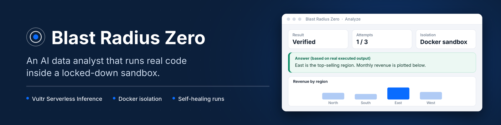
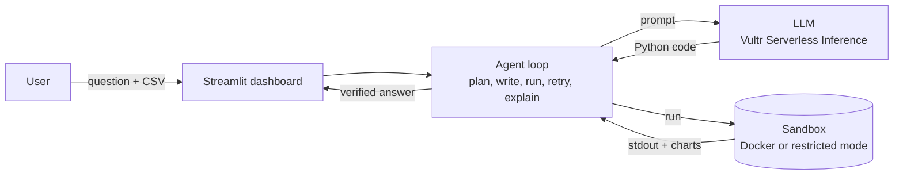

<p align="center">
  
</p>

<p align="center">
  <b>An AI data analyst that runs real code, and keeps every run inside a locked-down sandbox.</b><br>
  Built for the <a href="https://lablab.build/ai-hackathons/vultr-hackathon">Vultr Agent Rush</a> hackathon, challenge <i>Blast Radius Zero</i>.
</p>

<p align="center">
  
  
  
  
  
</p>

---

## What it does

Upload a CSV, ask a question in plain language, and get a verified answer with charts.

1. **Ask.** You describe what you want to know about your data.
2. **Write.** A language model (Vultr Serverless Inference, or any OpenAI-compatible API) writes Python for it.
3. **Run.** The code executes in a throw-away sandbox. If it fails, the error goes back to the model and it tries again (up to 3 attempts).
4. **Verify.** You see the real program output, the charts the code produced, and a plain-language explanation based only on that output.

The point is not just "AI that runs code". It is AI that runs code **without being able to hurt anything**.

## Features

| | |
|---|---|
| **Real execution** | The answer comes from output that actually ran, not from a model's guess |
| **Self-healing** | Errors, timeouts and out-of-memory kills are fed back to the model for a retry |
| **Containment Lab** | Six built-in attack programs (phone home, write to system paths, steal secrets, memory bomb, fork bomb, infinite loop) that must all be blocked |
| **Run report** | Every run shows exit code, code hash, container status and the limits that were applied. Download it as Markdown |
| **Dashboard UI** | Streamlit interface with dataset preview, charts, run log and history |
| **Two isolation modes** | Full Docker isolation on a server, or restricted mode where Docker is not available |

## Architecture



## Containment

Every run is limited, and the sandbox is destroyed afterwards.

| Risk | Docker mode (server) | Restricted mode (no Docker) |
|---|---|---|
| Code reaches the host | Separate container, non-root user, all capabilities dropped | Static code policy rejects dangerous imports, file access and dunder tricks before running |
| Code calls home | `--network none` | Network libraries are not on the import allow-list |
| Code steals API keys | Container gets zero environment variables | Child process gets an empty environment, and the parent process is made non-dumpable on Linux |
| Code damages the system | Read-only filesystem, small non-executable temp space | Writes are only allowed inside the run's output folder |
| Code hogs resources | 256 MB memory, 0.5 CPU, 64 processes, 20 s timeout | 800 MB memory cap, CPU time and file size limits, 20 s timeout |
| Leftovers | Container and temp folder deleted after each run | Temp folder deleted after each run |

> **Be aware:** restricted mode is best effort. It stops common attacks and passes the built-in Containment Lab, but it is **not** equivalent to container isolation. Use Docker mode for anything beyond a demo.

## Quick start

You need Python 3.10+ and an API key for an OpenAI-compatible provider (Vultr Serverless Inference, Groq, and so on).

```bash
git clone https://github.com/<your-username>/blast-radius-zero.git
cd blast-radius-zero

python -m venv .venv
# Windows:  .venv\Scripts\activate
# Mac/Linux: source .venv/bin/activate

pip install -r requirements.txt
cp .env.example .env        # Windows: copy .env.example .env
```

Edit `.env` and set your provider:

```ini
# Vultr Serverless Inference
VULTR_INFERENCE_API_KEY=your_key
VULTR_INFERENCE_BASE_URL=https://api.vultrinference.com/v1
VULTR_MODEL=Qwen2.5-Coder-32B-Instruct

# or Groq
# VULTR_INFERENCE_API_KEY=gsk_your_key
# VULTR_INFERENCE_BASE_URL=https://api.groq.com/openai/v1
# VULTR_MODEL=llama-3.3-70b-versatile
```

Run it:

```bash
streamlit run app.py
```

If Docker is installed, build the sandbox image first and the app uses it automatically:

```bash
docker build -t brz-sandbox:latest sandbox
```

Without Docker the app starts in restricted mode. Check the **Mode** line in the sidebar.

## Deploy

**Streamlit Community Cloud (free, restricted mode).** Push the repo to GitHub, create an app at share.streamlit.io with main file `app.py`, and paste `secrets.toml.example` (with your key) into the app's Secrets.

**Vultr Cloud Compute VM (Docker mode).** On a fresh Ubuntu 22.04 or 24.04 instance:

```bash
git clone https://github.com/<your-username>/blast-radius-zero.git && cd blast-radius-zero
sudo bash deploy/deploy.sh
sudo nano /opt/blast-radius-zero/.env       # add your key
sudo systemctl restart blast-radius-zero
```

This installs Docker, builds the sandbox image, and serves the FastAPI version behind nginx on port 80 (`app/main.py` + `frontend/`).

## Project structure

```
app.py                Streamlit dashboard (main entry point)
app/agent.py          write code, run, retry, explain
app/sandbox.py        containment boundary (Docker flags and restricted mode)
app/policy.py         static code policy for restricted mode
app/probes.py         Containment Lab attack programs
app/llm.py            OpenAI-compatible client (Vultr Serverless Inference)
app/main.py           FastAPI variant used on the VM
frontend/             HTML front end for the FastAPI variant
sandbox/Dockerfile    sandbox image (pandas, numpy, matplotlib, scipy)
deploy/               one-shot Vultr VM deploy (Docker, nginx, systemd, ufw)
samples/sales.csv     demo dataset
```

## Tech stack

Python, Streamlit, FastAPI, Docker, pandas, matplotlib, nginx, Vultr Cloud Compute, Vultr Serverless Inference (OpenAI-compatible API).

## Limitations

- Restricted mode is not container isolation (see the note above).
- The model can still write wrong analysis code. The explanation is built only from the real program output, so check the code tab for anything important.
- CSV files up to 5 MB, one file per question.
- Demo deployments apply a per-session run limit to protect API quota.

## Author

Built by **Hamna Munir**.

## License

MIT. See [LICENSE](LICENSE).
