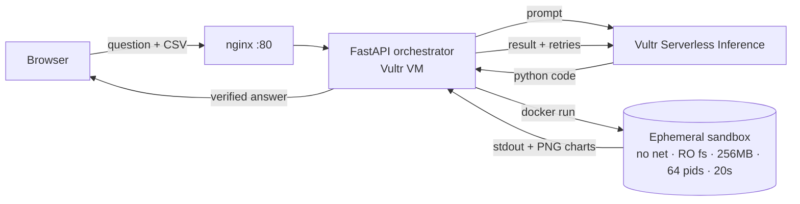

# Blast Radius Zero

**Vultr Agent Rush · Challenge 1 (Sandboxed code execution, Pattern A)**

A web agent that analyses your CSV by *actually running code* - and keeps every run inside a throw-away, locked-down container on a Vultr VM.

> User asks → model (Vultr Serverless Inference) writes Python → code runs in an isolated Docker sandbox → real output returns → errors are fed back for retries → model explains the verified result.

## Two ways to run

| Mode | Where | Isolation |
|---|---|---|
| **Docker mode** (`SANDBOX_MODE=docker`) | Vultr VM, `deploy/deploy.sh` | Full container isolation (see table below) |
| **Restricted mode** (automatic when Docker is missing) | e.g. Streamlit Community Cloud | Best effort: static code policy (import/file/env/dunder checks), 800 MB memory cap, CPU/time/file-size limits, empty environment. Not equal to a container |

The Streamlit demo (`streamlit run app.py`) works in both modes. The FastAPI + HTML version (`app/main.py`, `frontend/`) is the VM production variant.

## Why it fits the challenge

| Requirement | How it is met |
|---|---|
| Vultr as central control layer | FastAPI orchestrator runs on a Vultr Cloud Compute VM (nginx + systemd) and decides what runs where |
| Vultr Serverless Inference | All agent LLM calls go to `https://api.vultrinference.com/v1` (OpenAI-compatible) |
| Process isolation | Model code never runs in the app process. Each run = new Docker container, non-root user, all capabilities dropped, `no-new-privileges` |
| Secret hygiene | The API key lives only in the host `.env`. The container receives **zero** host env vars. Uploaded CSVs are even parsed *inside* the sandbox |
| Resource limits | `--network none`, `--memory 256m` (no swap), `--cpus 0.5`, `--pids-limit 64`, 20 s wall-clock timeout, 64 MB noexec tmpfs |
| Lifecycle discipline | `--rm`, forced `docker rm -f`, temp dir wiped, and the API reports `container_destroyed` / `workdir_wiped` per run |
| Verifiable output | Result shows exit code, stdout/stderr, code SHA-256, container name, charts produced by the code |
| Self-healing | Failed runs (error, timeout, OOM) are fed back to the model, up to `MAX_ATTEMPTS` |

## Architecture



Code layout:

```
app/main.py      HTTP API, rate limit, concurrency cap
app/agent.py     plan -> code -> run -> retry -> explain
app/sandbox.py   the containment boundary (docker flags live here)
app/probes.py    "Containment Lab" attack programs
app/llm.py       Vultr Serverless Inference client + model auto-resolve
frontend/        single-page UI
sandbox/         sandbox image (python + pandas/numpy/matplotlib/scipy)
deploy/          one-shot Vultr VM deploy (docker, nginx, systemd, ufw)
```

## Containment Lab (the demo moment)

The UI has six hostile programs: phone home, write to system paths / find `docker.sock`, steal env secrets, memory bomb, fork bomb, infinite loop. They run through the same sandbox as normal analysis. Each must show **Contained**: network unreachable, filesystem read-only, no secrets, OOM-killed, process cap hit, timeout-killed. 

## Run on a Vultr VM (about 10 minutes)

1. Claim the $200 credit (see the hackathon page) and create a Vultr **Serverless Inference** API key in the console.
2. Deploy a **Cloud Compute** instance: Ubuntu 24.04, 2 vCPU / 4 GB is plenty.
3. SSH in and:
   ```bash
   git clone <your-repo-url> && cd blast-radius-zero
   sudo bash deploy/deploy.sh
   sudo nano /opt/blast-radius-zero/.env      # set VULTR_INFERENCE_API_KEY (and VULTR_MODEL if you like)
   sudo systemctl restart blast-radius-zero
   ```
4. Open `http://<VM_IP>/`. The status pills at the top should all be green.
5. Pick a model: open `http://<VM_IP>/api/models`, copy a chat/coder model id into `VULTR_MODEL`. If the configured id does not exist the app auto-selects one.

Optional hardening: install gVisor and set `SANDBOX_RUNTIME=runsc`; add a domain + HTTPS with `certbot --nginx`.

## Run the Streamlit dashboard (any laptop, no Docker needed)

```bash
pip install -r requirements.txt
cp .env.example .env     # add your key (Vultr or any OpenAI-compatible provider)
streamlit run app.py
```

## Deploy free on Streamlit Community Cloud (restricted mode)

Push the repo to GitHub, create the app at share.streamlit.io with main file `app.py`, and paste `secrets.toml.example` (with your key) into the app's Secrets.

## Run locally without Docker (older note)

Set `SANDBOX_MODE=local` in `.env` and `pip install -r requirements-local.txt`. This runs model code as a plain local process: **not isolated**, for trying the UI only. The Containment Lab is disabled in this mode; use Docker mode on the VM for the real thing.

## Run locally (with Docker)

```bash
docker build -t brz-sandbox:latest sandbox
python3 -m venv .venv && source .venv/bin/activate
pip install -r requirements.txt
cp .env.example .env     # add your key
uvicorn app.main:app --reload
```

## API

| Route | Purpose |
|---|---|
| `POST /api/analyze` | multipart: `question`, optional `file` (CSV) |
| `GET /api/probes`, `POST /api/probes/{id}` | list / launch containment attacks |
| `GET /api/health` | docker, image, key and limit status |
| `GET /api/models` | live model list from Vultr |

## Demo video script (about 3 min)

1. **0:00** Problem: AI that runs code is dangerous. Show the Vultr VM + public URL.
2. **0:20** Load sample CSV, ask "Which region sells the most and how does revenue change by month?". Show the timeline, chart and verified stdout.
3. **1:10** Show a self-heal: ask something that breaks the first attempt (or show an attempt log), and the retry.
4. **1:40** **Containment moment:** open the Containment Lab, click *Run all attacks*. Narrate each: no network, read-only FS, zero secrets, memory killed, fork bomb capped, loop timed out - and `container destroyed: true`.
5. **2:30** Architecture slide and what is on Vultr (VM, Serverless Inference).

## Submission checklist

- [ ] GitHub repo with this README
- [ ] Vultr VM running (`deploy/deploy.sh`)
- [ ] Public demo URL
- [ ] Demo video with the containment moment
- [ ] Architecture + use-case explanation (this README)

## Security notes

- The `brz` service user is in the `docker` group, so the **orchestrator host must be trusted and single-purpose**. Model code never gets that access: it only sees the container.
- Do not mount the Docker socket into any container.
- Rate limit (12 runs/min/IP) and a concurrency cap protect the VM from abuse.
